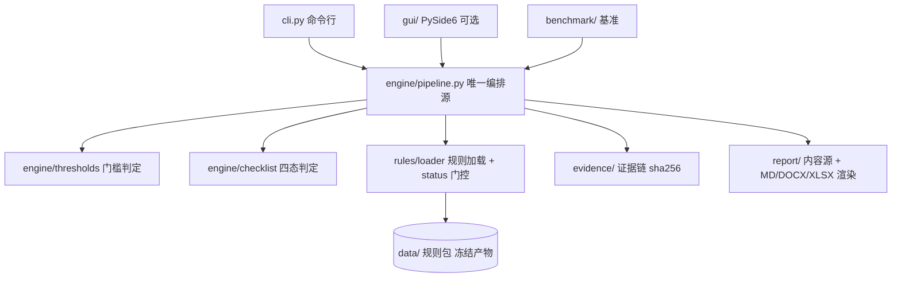
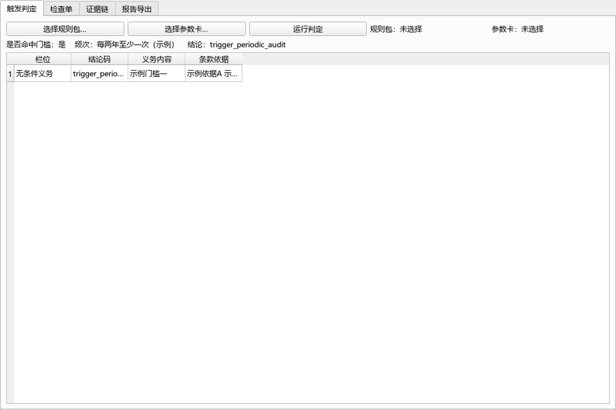

# 个人信息保护合规审计工作台（pipl-compliance-audit-workbench）

[](https://github.com/yuluo554/pipl-compliance-audit-workbench/actions/workflows/ci.yml)
[](https://github.com/yuluo554/pipl-compliance-audit-workbench/releases)
[](LICENSE)


> **本地目录** `10-13-pipl-compliance-audit-workbench`（`10-13` = 2026-10-13 日期标签）。**GitHub 仓库名** = `pipl-compliance-audit-workbench`（纯净名）。
> **状态**：✅ **v0.1.0 已发布（2026-10-14）**——M0–M6 全部收官。PySide6 **四页签**桌面应用（只消费引擎 API）、PyInstaller **onedir 双 exe**（GUI + CLI，版权红线三重守门）、报告导出 **MD/DOCX/XLSX**（模板两版，**逐字节可复现**）、技术报告 [docs/技术报告.md](docs/技术报告.md)。真值库 **42 例**、基准 **206/206**、双解释器 **223 passed**、脱敏审计（四步）HARD=0。演示素材见 [docs/demo](docs/demo)。

**下载**：Windows 免安装版见 [Releases](https://github.com/yuluo554/pipl-compliance-audit-workbench/releases)——`paudit-cli-v0.1.0-win64.zip`（命令行，约 20 MB）、`paudit-gui-v0.1.0-win64.zip`（桌面应用，约 59 MB）。解压后直接运行 `paudit-cli.exe` / `paudit-gui.exe`，**无需装 Python**（首次运行 Windows SmartScreen 可能提示"未知发布者"，属未签名预期）。

把「**是否触发审计义务 → 逐项怎么查 → 查到问题怎么留证 → 怎么出报告**」整条链做成**规则化、可复现、证据可追溯**的本地工作台（Windows 桌面 + CLI 双形态，全本地、零上传、默认不联网）。

**权威依据**：《个人信息保护合规审计管理办法》（国家互联网信息办公室令 **第 18 号**，**2025-05-01 施行**）+ GB/T 35273-2020 + GB/T 42574-2023。

## 为什么需要它

《审计办法》确立个人信息处理者的**定期合规审计义务**，企业侧真实痛点是：**我是否触发审计义务、多久做一次、审计要查哪些项、查出问题怎么留证据、怎么出报告**。现有开源工具集中在"App 隐私 API 技术检测"细分，**审计办法口径的"检查单 + 证据链 + 报告"工作台开源近乎空白**。

LLM 聊天给不了持久检查单、结构化底稿与证据指纹；本工具是审计准备与自评的质量防线。

## 核心特性

- **确定性门槛引擎**：按处理规模/敏感信息/处理者类型判定是否触发审计义务、适用频次、是否须指定负责人；结论旁挂**条款依据**（办法第四条/第五条/第十二条）；门槛值一律从规则包读取，引擎源码零门槛字面量。
  **三分判定**：无条件义务（周期性/持续性，处理者自身义务）与**条件触发**（保护部门"可以要求"，非处理者无条件义务）**分栏呈现**，结论不混同。
- **版本化审计规则集**：规则包按 `依据文件 × 版本` 组织、JSON 化、生成器产出、禁手改；条款变更即升版本；切换版本即切换检查单与门槛值。
- **审计检查单引擎**：以办法附件《审计指引》**27 项审查要点**为骨架，分制度/流程/技术/响应四层；支持自动核查项与人工核查项。自动核查项的"取值 → 四态"映射**收进规则包**（`auto_mapping`），引擎零业务字面量；《指引》中"应当制定/应当采取"类**无条件义务项未制定即判不符合**（不误记"不适用"）。
- **判定语义分层**（不误报合规）：`compliant`/`partial`/`noncompliant`/`not_applicable`（不适用）+ `unknown`（未观测）；**一条都不适用或都没评 → `not_assessed`（未评估），绝不输出 `compliant`**。
- **证据链留痕**：结论挂本地证据引用 + **sha256 指纹**固化进底稿；底稿导出产物自身也挂指纹（"底稿被改动即可检出"）；底稿可整体导出/导入，**导入三重校验**（自指纹 + `schema_version` + `ruleset_id`）+ **往返一致性**（离线重算结论须与底稿一致）；`evidence --check` 可复核证据文件指纹。证据仅登记文件名与指纹，**不落真实内容副本**。
- **问题分级与整改台账**：高风险/中风险（挂条款依据），台账可填 `owner`/`due`/`status`（待整改/整改中/已整改/已豁免）并导出 CSV；台账**只补责任落实，不覆写**分级与依据。
- **报告导出（三格式、模板两版、可复现）**：Markdown（核心零依赖）+ DOCX/XLSX（可选 extra）；三格式共用**单一内容源**（`report/model.py`），故同一底稿在三产物里结论一致；报告头固定输出**规则包坐标**；模板可配置（企业自审版 / 第三方机构版）。DOCX/XLSX 落盘后经 `report/docxutil.py` 统一收口（固定 zip 时间戳 + `create_system=0` + 固定 core.xml 时间戳），**逐字节可复现**。
- **桌面应用（PySide6，四页签）**：触发判定 / 检查单 / 证据链 / 报告导出；界面拆为**纯 Python 数据面**（`gui/session.py`，零 Qt、可无头测试）与 **Qt 装配层**，**只消费引擎 API、零判定逻辑**。
- **发行形态（PyInstaller onedir 双 exe）**：GUI 与 CLI 各一个 onedir 产物；数据白名单由 `tools/build_data.py` 单一实现源展开，**版权红线三重守门**（构建前抛错 + spec 文本守门 + 构建后 dist 扫描）。
- **内置评测基准**：门槛边界 / 检查项自洽 / 合成场景 / 四态判定覆盖四类，零 API 依赖可重复，一条命令跑全。

## 架构



**分层纪律**：表现层（cli/gui）零判定逻辑，只调引擎；`effective_ruleset()` 是唯一生效门，`status=pending` 条目在此被拒；严格核心层仅标准库，不 import PySide6/docx/openpyxl（AST 静态守门 G3）。GUI 与 DOCX/XLSX 渲染器属**惰性边界层**，重件只在函数体内导入，故未装 extra 时核心通路仍可跑。

## 快速开始

```bash
# 需要 Python 3.8+（Windows 用 py 启动器显式指定：py -3.12 / py -3.8）
py -3.12 -m venv .venv
.venv\Scripts\activate          # Windows；Linux/macOS: source .venv/bin/activate
python -m pip install -U pip
python -m pip install -e ".[dev]"

# 1) 跑内置基准（用示例规则包，验证工具链路）
python -m paudit bench --ruleset data/samples/ruleset-pipl-audit-demo.json

# 2) 试用单件审计（示例参数卡 → 底稿；挂证据固化 sha256）
python -m paudit check data/samples/card-demo.json --ruleset data/samples/ruleset-pipl-audit-demo.json \
    --out draft.json --draft --evidence "CHK-DEMO-001=data/samples/evidence-demo.txt" --evidence-owner 审计员A

# 3) 整改台账（填写责任人/期限/状态，并导出 CSV）
python -m paudit ledger draft.json --apply data/samples/ledger-demo.json -o ledger.csv --write-draft draft2.json

# 4) 底稿导出（固化自指纹）→ 导入（三重校验 + 往返一致性）
python -m paudit draft export draft2.json -o frozen.json --ruleset data/samples/ruleset-pipl-audit-demo.json
python -m paudit draft import frozen.json --ruleset data/samples/ruleset-pipl-audit-demo.json

# 5) 导出报告（.md / .docx / .xlsx，模板 self / third_party）
#    DOCX/XLSX 需 report extra；Markdown 无需任何可选依赖
python -m pip install -e ".[report]"
python -m paudit report frozen.json --ruleset data/samples/ruleset-pipl-audit-demo.json \
    -o report.docx --template third_party

# 6) 启动桌面应用（四页签：触发判定 / 检查单 / 证据链 / 报告导出）
python -m pip install -e ".[gui]"
python -m paudit gui

# 7) 跑全量测试（[report]+[gui] 全装则 0 skip；只装 [dev] 时相关用例声明式跳过）
python -m pytest -q
```

**打包发行（onedir 双 exe）**：

```bash
python -m pip install -e ".[gui,report,pkg]"
python -m PyInstaller tools/paudit-cli.spec --noconfirm   # dist/paudit-cli/paudit-cli.exe
python -m PyInstaller tools/paudit-gui.spec --noconfirm   # dist/paudit-gui/paudit-gui.exe
```

> **注意**：`data/samples/` 是**示例规则包**（门槛值为合成示例值，**非法规门槛**），仅用于试用工具流程与演示，**不得据以作出任何合规结论**。权威规则包在 `data/rules/`，M1 已逐条挂原文核对生效（26 检查项 + 4 门槛全 `verified`，见 [data/README.md](data/README.md) §一/§二）。

## 演示



演示素材由 `tools/make_demo_assets.py` **离线合成**（零网络、零真实数据，一律用 `data/samples/` 示例规则包），重跑逐字节一致；含四页签截图与 CLI 基准卡片，产物清单与 sha256 见 [docs/demo/MANIFEST.json](docs/demo/MANIFEST.json)。

| 截图 | 内容 |
|---|---|
| [触发判定](docs/demo/01-trigger.png) | 门槛结论 + 频次 + **义务分栏**（无条件义务 / 条件触发） |
| [检查单](docs/demo/02-checklist.png) | 全项四态 + 说明 + 条款依据 |
| [证据链](docs/demo/03-evidence.png) | 挂证（文件名 + sha256）+ 整改台账三字段 |
| [报告导出](docs/demo/04-report.png) | MD/DOCX/XLSX + 模板两版 + 底稿自指纹 |
| [CLI 基准](docs/demo/cli-bench.png) | `paudit bench` 权威规则包 **206/206** |


## CLI 命令与退出码

| 子命令 | 作用 | 退出码 |
|---|---|---|
| `check <参数卡>` | 单件审计（门槛 + 检查单）；`--draft` 以底稿形态导出；`--evidence 检查项=文件` 挂证 | 0=全部符合 / 1=检出非合规或未评估 / 2=输入不可用 |
| `bench [--ruleset R] [--json]` | 跑内置基准（`--json` 输出指标 `metrics` 与门值 `gates`） | 0=达标 / 1=未达标或门控拦截 / 2=用法错误 |
| `report <底稿> -o <输出>` | 导出报告（`.md` / `.docx` / `.xlsx`），`--template self|third_party` | 0=完成 / 2=输入不可用 / 3=缺文档导出依赖 |
| `evidence <底稿> --add 检查项=文件` | 证据挂载（sha256 固化）；`--check` 复核已挂证据指纹 | 0=完成 / 1=指纹不匹配 / 2=输入不可用 |
| `draft export <输入> -o <底稿>` | 导出底稿并固化自指纹（写 `.evidence.json`） | 0=完成 / 2=输入不可用 |
| `draft import <底稿>` | 导入底稿：校验自指纹/schema/ruleset + 往返一致性 | 0=通过 / 1=结论漂移 / 2=校验不通过 |
| `ledger <底稿> [--apply 台账] [-o out.csv]` | 整改台账填写 / 导出（CSV） | 0=完成 / 2=输入不可用 |
| `gui` | 启动桌面应用（缺依赖 exit 3） | 0 / 2 / 3 |

## 评测基准

四类套件（B1 门槛边界 / B2 检查项自洽 / B3 合成场景 / B4 四态判定覆盖）由 `python -m paudit bench` **一条命令跑全**，零 API 依赖、可重复；权威规则包上 **206/206**、全量单次约 **0.08 秒**（含解释器启动）。

| 基准 | 内容 | 断言数 | 指标 |
|---|---|---|---|
| B1 门槛边界 | 门槛值 ±1 人枚举（恰好等于/上下 1 人）+ 义务类型分栏核对 | 18 | 触发判定正确率 |
| B2 检查项自洽 | 条款引用完整性、id 唯一性 | 26 | 断言通过率 |
| B3 合成审计场景 | 真值库对账（触发判定/四态判定/门槛分栏结论） | 42 | 触发判定准确率 / 四态准确率 / 误报率 |
| B4 四态判定覆盖 | auto 映射词表逐值核对（引擎 vs 独立实现）+ 缺项口径回归锁 + 汇总语义 | 120 | 映射一致率 |

**实测指标（权威规则包，`bench --json` 的 `metrics` 字段）**：

| 指标 | 实测值 | 样本量 | 门值 | 达标 |
|---|---|---|---|---|
| 触发判定准确率 `trigger_accuracy` | **1.0000** | 54（B1 边界 12 + B3 场景 42） | ≥ 0.95 | ✅ |
| 四态准确率 `state_accuracy` | **1.0000** | 1092（42 场景 × 26 检查项逐项对账） | ≥ 0.95 | ✅ |
| 误报率 `false_positive_rate` | **0.0000** | 982（真值非问题项数；分母口径见下） | = 0 | ✅ |
| 漏报率 `miss_rate`（参考） | **0.0000** | 110（真值问题项数） | — | — |
| auto 映射一致率 `mapping_accuracy`（参考） | **1.0000** | 90（9 auto 项 × 10 探针值） | — | — |

> **误报率口径（唯一实现源 `benchmark/cases.py` 的 `confusion()`）**：以**二元"问题"口径**逐项比对——
> **问题 = `partial` ∪ `noncompliant`**；`compliant`/`not_applicable`/`unknown` 均视为"非问题"（不构成判错）。
> **误报 FP** = 真值非问题而引擎判问题（引擎多报）；**误报率 = FP ÷ 真值非问题项数**；
> **漏报 FN** 反之，**漏报率 = FN ÷ 真值问题项数**（分母为 0 时记 0）。真值取真值库冻结的
> `expected.item_states`（**生成期由 `cases.expected_item_states()` 独立推导，非引擎计算**），
> 故"引擎判对"是两套独立实现互验的结果，而非自证。

> 示例规则包（`data/samples/`）无匹配真值库 → B3 如实标注"该类用例未生成"，指标样本量相应减少；门禁对**无样本**指标不阻塞（"无证据"≠"不达标"），权威包三指标样本量均 > 0，故为强约束。

> M2 状态：B1/B2/B3/B4 在**权威规则包**上全绿（B1 18/18、B2 26/26、B3 **42/42** 合成场景真值对账、B4 120/120；**合计 206/206**）；示例规则包上 B3 如实标注"该类用例未生成"（示例包无匹配真值库）。

## 桌面应用与报告导出（M5）

**桌面应用**分四页签，只消费引擎 API（零判定逻辑）：

| 页签 | 内容 |
|---|---|
| 触发判定 | 门槛结论 + 频次 + **义务分栏**（无条件义务 / 条件触发，不得混同） |
| 检查单 | 全项四态 + 说明 + 条款依据 |
| 证据链 | 挂证（仅登记文件名 + sha256）；整改台账三字段可编辑（只补责任落实，不改结论） |
| 报告导出 | MD/DOCX/XLSX + 模板两版；导出底稿（固化自指纹）与台账 CSV |

界面拆为**纯 Python 数据面** `gui/session.py`（零 Qt 依赖，可用普通 pytest 无头覆盖）与
**Qt 装配层** `gui/main_window.py`（重件只在函数体内导入）。因此业务正确性由无头测试守住，
GUI 冒烟只验"能构建、能渲染"。

**报告导出**三格式共用单一内容源 `report/model.py`，故同一底稿在三产物里结论一致：

| 产物 | 渲染器 | 确定性收口 |
|---|---|---|
| `.md` | `report/markdown.py`（核心层，零依赖） | 无系统时间戳 |
| `.docx` | `report/docx.py`（optional extra） | `report/docxutil.py`：固定 zip 时间戳 + `create_system=0` + 固定 core.xml 时间戳 |
| `.xlsx` | `report/xlsx.py`（optional extra） | 同上（openpyxl 在 save 时才覆盖时间戳，故必须落盘后收口） |

实测六种"格式 × 模板"组合**逐字节可复现**（含跨时间间隔的两次导出）。

**发行形态**：PyInstaller onedir 双 exe（`tools/paudit-cli.spec` / `tools/paudit-gui.spec`）。
数据白名单由 `tools/build_data.py` 单一实现源展开，**版权红线三重守门**——构建前命中禁区即抛错、
spec 文本守门（不含禁区字面量）、构建后 dist 扫描。实测两个 exe 在**干净目录**独立运行，
产物树内 `data/` 只含 `rules/`、`samples/`、`truth/`，无官方原文快照。

## 数据与依据

- 依据查证与条款核对实录见 [data/README.md](data/README.md)（含办法条款逐条核对与勘误）。
- **重要勘误**：调研期曾记"处理超过 **100 万人**每两年一次"；官方原文（cac.gov.cn 令第 18 号全文）实为 **第四条：超过 1000 万人每两年一次**，**第十二条：100 万人以上须指定个人信息保护负责人**。详见 [plan/01](plan/01-题目详细定义.md) 顶部勘误与 [data/README.md](data/README.md) §二·1。
- 审计场景一律使用**合成/脱敏数据**，禁止真实个人信息入库。

## 项目文档

| 文档 | 内容 |
|---|---|
| [plan/00-README总览.md](plan/00-README总览.md) | 文档索引 / 决策记录 / 里程碑 |
| [plan/01-题目详细定义.md](plan/01-题目详细定义.md) | 项目题全文 + 勘误 |
| [plan/02-需求解读.md](plan/02-需求解读.md) | FR 清单 / NFR / 边界守卫 |
| [plan/03-架构与技术选型.md](plan/03-架构与技术选型.md) | 分层架构 / 目录布局 |
| [plan/04-模块详设.md](plan/04-模块详设.md) | 规则包 schema / 判定语义 / 门禁 |
| [plan/05-数据计划与里程碑.md](plan/05-数据计划与里程碑.md) | 数据入库策略 / M0–M6 DoD |
| [plan/06-决策记录.md](plan/06-决策记录.md) | 重大决策表 / 本机环境坑 |
| [plan/HANDOFF-M3.md](plan/HANDOFF-M3.md) | 交接快照（M2 → M3：证据链与整改） |
| [plan/HANDOFF-M4.md](plan/HANDOFF-M4.md) | 交接快照（M3 → M4：内置基准） |
| [plan/HANDOFF-M5.md](plan/HANDOFF-M5.md) | 交接快照（M4 → M5：桌面交付 + 报告导出） |
| [plan/HANDOFF-M6.md](plan/HANDOFF-M6.md) | 交接快照（M5 → M6：脱敏发布 + Release） |
| [plan/HANDOFF-M7.md](plan/HANDOFF-M7.md) | 交接快照（M6 → 后续：发布现状 / 后续可选迭代 / 环境坑） |
| [docs/技术报告.md](docs/技术报告.md) | 技术报告（定位 / 架构 / 确定性内核 / 基准 / 桌面交付 / 门禁 / 局限） |
| [docs/demo/](docs/demo/) | 演示素材（四页签截图 / GIF / CLI 基准卡片 / sha256 清单） |

## 限制与非目标

- ❌ 不做 App/小程序隐私 API 动态/静态技术检测（属另一细分）；❌ 不做法律意见出具；❌ 不做自动化数据爬取核查；❌ 不对接监管申报接口。
- 首期依据限定三份（办法令第 18 号 + GB/T 35273-2020 核心章节 + GB/T 42574-2023）。
- 工具输出为**合规检查发现**，不构成法律意见；正式合规结论以监管口径或执业机构意见为准。

## 免责声明

本工具输出为**合规检查发现，不构成法律意见**；正式合规结论以监管口径或执业机构意见为准。规则包中 `status=pending` 的条目**未挂原文核对，不参与任何判定**；`status=verified` 但缺出处（`channel`/`checked_at`）的条目同样被门控拒绝（"已核对"必须可追溯）。

## 许可

MIT，见 [LICENSE](LICENSE)。
