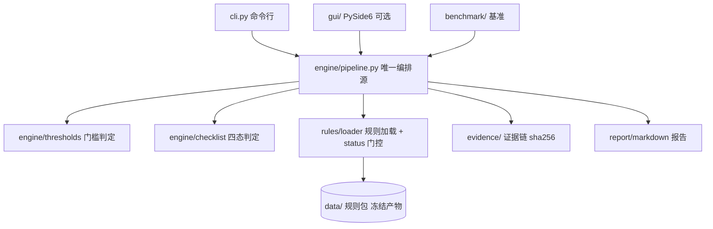

# 个人信息保护合规审计工作台（pipl-compliance-audit-workbench）

> **本地目录** `10-13-pipl-compliance-audit-workbench`（`10-13` = 2026-10-13 日期标签）。**GitHub 仓库名** = `pipl-compliance-audit-workbench`（纯净名）。
> **状态**：🚧 **M0 骨架就绪（2026-10-13）**，权威规则包待 M1 逐条核对后生效。

把「**是否触发审计义务 → 逐项怎么查 → 查到问题怎么留证 → 怎么出报告**」整条链做成**规则化、可复现、证据可追溯**的本地工作台（Windows 桌面 + CLI 双形态，全本地、零上传、默认不联网）。

**权威依据**：《个人信息保护合规审计管理办法》（国家互联网信息办公室令 **第 18 号**，**2025-05-01 施行**）+ GB/T 35273-2020 + GB/T 42574-2023。

## 为什么需要它

《审计办法》确立个人信息处理者的**定期合规审计义务**，企业侧真实痛点是：**我是否触发审计义务、多久做一次、审计要查哪些项、查出问题怎么留证据、怎么出报告**。现有开源工具集中在"App 隐私 API 技术检测"细分，**审计办法口径的"检查单 + 证据链 + 报告"工作台开源近乎空白**。

LLM 聊天给不了持久检查单、结构化底稿与证据指纹；本工具是审计准备与自评的质量防线。

## 核心特性

- **确定性门槛引擎**：按处理规模/敏感信息/处理者类型判定是否触发审计义务、适用频次、是否须指定负责人；结论旁挂**条款依据**（办法第四条/第五条/第十二条）；门槛值一律从规则包读取，引擎源码零门槛字面量。
- **版本化审计规则集**：规则包按 `依据文件 × 版本` 组织、JSON 化、生成器产出、禁手改；条款变更即升版本；切换版本即切换检查单与门槛值。
- **审计检查单引擎**：以办法附件《审计指引》**27 项审查要点**为骨架，分制度/流程/技术/响应四层；支持自动核查项与人工核查项。
- **判定语义分层**（不误报合规）：`compliant`/`partial`/`noncompliant`/`not_applicable`（不适用）+ `unknown`（未观测）；**一条都不适用或都没评 → `not_assessed`（未评估），绝不输出 `compliant`**。
- **证据链留痕**：结论挂本地证据引用 + **sha256 指纹**固化进底稿；底稿导出产物自身也挂指纹（"底稿被改动即可检出"）；底稿可整体导出/导入，支持跨会话续做。
- **问题分级与整改台账**：高风险/中风险/低风险/建议，分级挂条款依据；整改台账可导出。
- **报告导出**：Markdown（核心零依赖）+ DOCX/XLSX（可选）；报告头固定输出**规则包坐标**；模板可配置（企业自审版 / 第三方机构版）。
- **内置评测基准**：门槛边界 / 检查项自洽 / 合成场景三类，零 API 依赖可重复，一条命令跑全。

## 架构



**分层纪律**：表现层（cli/gui）零判定逻辑，只调引擎；`effective_ruleset()` 是唯一生效门，`status=pending` 条目在此被拒；核心层仅标准库，不 import PySide6/docx/openpyxl（AST 静态守门）。

## 快速开始

```bash
# 需要 Python 3.8+（Windows 用 py 启动器显式指定：py -3.12 / py -3.8）
py -3.12 -m venv .venv
.venv\Scripts\activate          # Windows；Linux/macOS: source .venv/bin/activate
python -m pip install -U pip
python -m pip install -e ".[dev]"

# 1) 跑内置基准（用示例规则包，验证工具链路）
python -m paudit bench --ruleset data/samples/ruleset-pipl-audit-demo.json

# 2) 试用单件审计（示例参数卡 → 结论）
python -m paudit check data/samples/card-demo.json --ruleset data/samples/ruleset-pipl-audit-demo.json --out draft.json

# 3) 导出报告
python -m paudit report draft.json --ruleset data/samples/ruleset-pipl-audit-demo.json -o report.md

# 4) 跑全量测试
python -m pytest -q
```

> **注意**：`data/samples/` 是**示例规则包**（门槛值为合成示例值，**非法规门槛**），仅用于试用工具流程与演示，**不得据以作出任何合规结论**。权威规则包在 `data/rules/`，其条目在 M1 逐条核对前为 `status=pending`，**引擎会拒绝其进入判定路径**（这是"未核对不得生效"的硬门）。

## CLI 命令与退出码

| 子命令 | 作用 | 退出码 |
|---|---|---|
| `check <参数卡>` | 单件审计（门槛 + 检查单） | 0=全部符合 / 1=检出非合规或未评估 / 2=输入不可用 |
| `bench [--ruleset R]` | 跑内置基准 | 0=达标 / 1=未达标或门控拦截 / 2=用法错误 |
| `report <底稿> -o <输出>` | 导出报告（.md） | 0=完成 / 2=输入不可用 |
| `gui` | 启动桌面应用（缺依赖 exit 3） | 0 / 2 / 3 |

## 评测基准

| 基准 | 内容 | 指标 |
|---|---|---|
| B1 门槛边界 | 门槛值 ±1 人枚举（恰好等于/上下 1 人） | 判定正确率 |
| B2 检查项自洽 | 条款引用完整性、id 唯一性 | 断言通过率 |
| B3 合成审计场景 | 真值库对账（触发判定/四态判定） | 准确率 / 误报率 |

> M0 状态：B1/B2 在示例规则包上通过；**B3 真值库未生成**（`data/truth/` 空），基准如实标注"该类用例未生成"，**不假装覆盖**。

## 数据与依据

- 依据查证与条款核对实录见 [data/README.md](data/README.md)（含办法条款逐条核对与勘误）。
- **重要勘误**：调研期曾记"处理超过 **100 万人**每两年一次"；官方原文（cac.gov.cn 令第 18 号全文）实为 **第四条：超过 1000 万人每两年一次**，**第十二条：100 万人以上须指定个人信息保护负责人**。详见 [plan/01](plan/01-题目详细定义.md) 顶部勘误与 [data/README.md](data/README.md) §二·1。
- 审计场景一律使用**合成/脱敏数据**，禁止真实个人信息入库。

## 项目文档

| 文档 | 内容 |
|---|---|
| [plan/00-README总览.md](plan/00-README总览.md) | 文档索引 / 决策记录 / 里程碑 |
| [plan/01-题目详细定义.md](plan/01-题目详细定义.md) | 项目题全文 + 勘误 |
| [plan/02-需求解读.md](plan/02-需求解读.md) | FR 清单 / NFR / 边界守卫 |
| [plan/03-架构与技术选型.md](plan/03-架构与技术选型.md) | 分层架构 / 目录布局 |
| [plan/04-模块详设.md](plan/04-模块详设.md) | 规则包 schema / 判定语义 / 门禁 |
| [plan/05-数据计划与里程碑.md](plan/05-数据计划与里程碑.md) | 数据入库策略 / M0–M6 DoD |
| [plan/06-决策记录.md](plan/06-决策记录.md) | 重大决策表 / 本机环境坑 |
| [plan/HANDOFF-M1.md](plan/HANDOFF-M1.md) | 下一里程碑交接快照 |

## 限制与非目标

- ❌ 不做 App/小程序隐私 API 动态/静态技术检测（属另一细分）；❌ 不做法律意见出具；❌ 不做自动化数据爬取核查；❌ 不对接监管申报接口。
- 首期依据限定三份（办法令第 18 号 + GB/T 35273-2020 核心章节 + GB/T 42574-2023）。
- 工具输出为**合规检查发现**，不构成法律意见；正式合规结论以监管口径或执业机构意见为准。

## 免责声明

本工具输出为**合规检查发现，不构成法律意见**；正式合规结论以监管口径或执业机构意见为准。规则包中 `status=pending` 的条目**未挂原文核对，不参与任何判定**。

## 许可

MIT，见 [LICENSE](LICENSE)。
